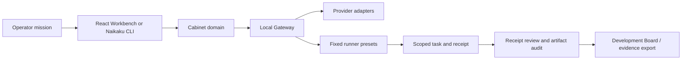

# Naikaku AI Togo System 工程交接资料

> 面向接手开发、技术合作、代码审阅和部署评估。本文只描述当前公开仓库中可追溯的代码、文档和本地验证路径；不把设计设想、fixture 演练或本地 dry-run 写成生产能力。

## 1. 快照与定位

| 项目 | 当前事实 |
| --- | --- |
| 代码仓库 | <https://github.com/YAHATAKAHA/naikaku-ai-togo-system> |
| GitHub 可见性 | **Public**，已于本次交接重新查询 GitHub 确认。`package.json` 的 `private: true` 只阻止 npm 发布，并不代表 GitHub 私有。 |
| 默认分支 | `main` |
| 当前产品代码基线 | `b6efd76` `Polish Japanese-first Naikaku CLI`（2026-07-23） |
| 已发布标签 | `v0.1.0`，附 macOS developer preview 的 `.tar.gz`、`.zip` 与 SHA-256 文件：<https://github.com/YAHATAKAHA/naikaku-ai-togo-system/releases/tag/v0.1.0> |
| 产品定位 | 日本发、多模型、角色分工的 AI 内阁工作台；用于受治理的软件开发、自动化与证据复核。 |
| 主语言 | 日语优先；产品层支持英文、简体中文、繁体中文、韩语。 |
| 许可证 | PolyForm Noncommercial 1.0.0。非商业研究/实验可用；商用、客户交付、SaaS、托管、转售或商业修改需取得 EMYSTI 的书面许可。见 [LICENSE](../LICENSE) 与 [COMMERCIAL-LICENSE.md](../COMMERCIAL-LICENSE.md)。 |

### 证据阅读方式

本文使用三种状态，接手时请保持这个区分：

| 状态 | 含义 |
| --- | --- |
| 已确认 | 当前代码存在，且可由本地测试、构建或明确的命令重复验证。 |
| 待运营者验证 | 代码提供接入点，但依赖接手者的账户、API key、本机 CLI、权限或部署环境。 |
| 不在仓库范围 | 代码仓库刻意不包含，不能据此推断已交付。 |

## 2. 这套系统实际做什么

Naikaku 不是一个把所有权限交给单个模型的聊天或桌面接管工具。它把一个任务拆成内阁角色、执行器合同、证据与验收链：



默认内阁有 8 个角色：

1. Prime Minister：任务入口和总体协调。
2. Strategy Minister：规划和风险拆解。
3. Execution Minister：工程执行方案。
4. Sandbox Operator：受限沙箱/电脑控制执行方案。
5. Opposition Critic：反向审阅与挑错。
6. Safety Auditor：策略、权限和安全监督。
7. Scoring Office：评分与是否继续的判断。
8. Memory Secretary：候选经验和下一轮改进。

默认执行器 profile 为 Browser Sandbox、Desktop VM、Shell Container、MCP Proxy、Human Approval Gate。它们是合同和策略层的抽象，不代表仓库内含完整的浏览器或 macOS 自动控制驱动。

## 3. 已实现模块与当前边界

| 模块 | 已实现内容 | 证据状态 | 交接注意事项 |
| --- | --- | --- |
| Web Workbench | React/Vite 操作台；任务输入、角色配置、Provider Readiness、Sandbox、审计、开发板、收据/证据面板和导出。 | 已确认代码与构建路径。 | UI 文案已建立五语言机制，但并非每个旧面板都完成全量本地化；不要把“支持五语言”理解为每一处历史文字都已翻译完。 |
| 内阁编排 | 确定性 dry-run、角色阶段、评分、自动化计划与人工可审阅的下一步。 | 已确认域模块与测试。 | `dry-run` 不调用外部模型；其产物不能当作真实模型工作证据。 |
| Provider 接入 | Gateway 有 OpenAI Responses、Anthropic Messages、OpenAI-compatible/OpenRouter、Gemini `generateContent`、自定义 JSON endpoint 的服务端调用层；配置层支持 Aliyun DashScope/Qwen 等 BYOK 用法。 | 已确认代码、mock/replay 和结构校验。 | 真实付费模型调用属于待运营者验证：需由使用者在 Gateway 环境中设置自己的密钥别名。 |
| Local Gateway | Node HTTP JSON 服务；默认监听 `127.0.0.1:8787`，提供 Provider、内阁、Runner、Ledger、收据、审计等 API。 | 已确认源码与 Gateway smoke 路径。 | 仓库不提供公网 Gateway、共享 token 或托管账户；本地运行时的实际状态以 `/health` 为准。 |
| `naikaku` CLI | `doctor`、`start`、`gateway`、`task`、`verify`；日语优先，支持五种 locale，TTY 下有轻量颜色。 | 已确认 CLI 测试与本机 `doctor`。 | `doctor` 只读检测，不会调用模型、Coding CLI 或桌面自动化。`task` 默认只准备任务和证据包。 |
| Coding runner 流程 | Brief -> Session bundle -> Dispatch manifest -> Invocation -> Intake -> Self-test -> Lease -> Sandbox runner -> Receipt -> Artifact audit。 | 已确认 fixture、Gateway smoke、收据和反伪证据链。 | 真正的 Codex/Claude/Qwen/OpenHands/OpenClaw 调用依赖本机安装、登录、许可和运行环境；不能以 fixture 结果宣称某个真实模型已完成业务代码。 |
| 桌面/浏览器控制 | 支持为 OpenClaw、browser-use、Playwright、Hammerspoon、E2B 等建立 adapter/profile、合同、审批、日志和证据要求。 | 合同与演练已确认。 | 不含一个开箱即用的“无限制控制 Mac”功能，也没有把 macOS 权限、浏览器会话或主机机密打包进仓库。真实接入仍需逐个 adapter 验证。 |
| 本地账本与记忆 | 浏览器本地保存非机密工作区、运行历史、审批、审计、开发板和记忆审阅；Gateway 在 `.naikaku-data/` 记录 approval/evidence ledger。 | 已确认代码。 | 这是本地、可导出的开发账本，不是生产级不可篡改审计存储。 |
| 发布与部署 | Dockerfile、Compose、运行时 Gateway URL 配置、macOS developer preview 打包脚本。 | 已确认部署检查路径。 | 不是已签名 `.dmg`/`.pkg`，不是已托管的 EMYSTI 云服务，也不包含官网/服务器配置。 |

## 4. 目录地图

```text
.
├── src/
│   ├── App.tsx                         主工作台状态与流程编排
│   ├── components/                     可视化面板与操作入口
│   ├── data/defaultCabinet.ts          默认角色、阶段、执行器与策略
│   ├── domain/                         可测试的业务合同、收据、策略、审计、导出
│   ├── i18n.ts                         ja/en/zh-Hans/zh-Hant/ko 文案与 locale 规则
│   └── styles.css                      工作台样式
├── server/
│   ├── gateway.ts                      本地 HTTP Gateway 路由总入口
│   ├── liveCabinet.ts                  dry-run / live 内阁运行分流
│   ├── providerAdapters.ts             服务端模型调用与 API key alias 解析
│   ├── engineeringRunnerPresets.ts     固定 CLI/adapter preset 模板
│   ├── codingAgentSandboxRunner.ts     allowlisted 本地验证命令执行器
│   ├── runnerAuth.ts                   shared/scoped runner 认证
│   ├── runnerScope.ts                  runner profile 作用域过滤
│   └── ledgerStore.ts                  本地 approval/evidence ledger
├── bin/naikaku.mjs                     可安装的第一方 CLI
├── scripts/                            本地演练、smoke、验证、打包和任务入口
├── docs/                               架构、Gateway、部署、安全、许可证与参考资料
├── public/naikaku-config.js            运行时 Gateway URL 配置入口
├── Dockerfile / compose.yaml           自托管 preview 基线
├── .env.example                        空白环境变量模板，不含真实凭据
└── .github/                            Issue 模板和 PR 模板
```

### 优先阅读的源文件

| 目的 | 文件 |
| --- | --- |
| 了解默认产品行为 | [src/data/defaultCabinet.ts](../src/data/defaultCabinet.ts)、[src/domain/types.ts](../src/domain/types.ts) |
| 了解内阁流程和评分 | [src/domain/orchestrator.ts](../src/domain/orchestrator.ts) |
| 了解 UI 到 Gateway 的请求合同 | [src/domain/gatewayClient.ts](../src/domain/gatewayClient.ts)、[server/gateway.ts](../server/gateway.ts) |
| 了解模型密钥与调用边界 | [server/providerAdapters.ts](../server/providerAdapters.ts)、[docs/api-adapters.md](./api-adapters.md) |
| 了解 Coding CLI / 外部工具适配 | [src/domain/externalRunnerAdapters.ts](../src/domain/externalRunnerAdapters.ts)、[server/engineeringRunnerPresets.ts](../server/engineeringRunnerPresets.ts) |
| 了解收据、证据和本地执行链 | [src/domain/codingAgentSandboxRunnerPreflight.ts](../src/domain/codingAgentSandboxRunnerPreflight.ts)、[server/codingAgentSandboxRunner.ts](../server/codingAgentSandboxRunner.ts) |
| 了解安全与授权边界 | [docs/security-sandbox.md](./security-sandbox.md)、[server/runnerAuth.ts](../server/runnerAuth.ts) |
| 了解本地持久化 | [src/domain/storage.ts](../src/domain/storage.ts)、[server/ledgerStore.ts](../server/ledgerStore.ts) |

## 5. 关键运行流

### A. 无密钥、本地可重复路径

这是新接手者第一天应跑通的路径，不会使用付费模型额度：

```bash
npm ci
npm run dev
```

另开一个终端启动本地 Gateway：

```bash
npm run gateway
```

检查本机依赖和 Gateway，不产生模型调用：

```bash
npm run naikaku -- doctor
```

完整的无 Provider 验证门：

```bash
npm run public-scope:check
npm run deployment:check
npm run strategy:iterate
npm run open-source:mvp-check
npm run test
npm run build
```

`npm run ci:open-source` 已将上述主要检查组合起来，适合作为 PR 前的标准基线。

### B. 真实 Provider 路径

1. 复制环境变量模板为本机忽略的 `.env`，或在 shell / 私有 vault / CI secret store 中设置变量。
2. 保持前端只保存 alias，例如 `NAIKAKU_OPENAI_API_KEY`；不要在浏览器存储、导出 JSON 或 Git 中保存 raw key。
3. 启动 Gateway 后，先做 Provider Readiness 结构检查；它不会自动消耗模型额度。
4. 仅在确定需要时，以 `live` 模式对一个角色发起真实调用，并查看 `providerStatus`、日志和后续 automation 是否被正确阻断或允许。

当前仓库没有共享 API key、EMYSTI 云额度或默认 Provider 账户。真实 Provider 可用性属于接手环境的待验证项。

### C. 本地 Coding CLI 路径

```bash
npm link
naikaku doctor
naikaku task "Prepare a reviewed implementation plan"
```

`task` 的默认行为是 `prepare`：生成可审阅的任务与证据文件，并不悄悄执行外部 Coding CLI。更深入的 mode、runner preset、guided loop、Codex smoke 用法见：

```bash
npm run naikaku:task -- --help
```

固定 preset 位于 [server/engineeringRunnerPresets.ts](../server/engineeringRunnerPresets.ts)，当前包括 Codex CLI、Claude Code、Qwen Code、OpenClaw local agent 与 OpenHands。浏览器只能选择 preset ID，不能把任意 shell 命令提交给 Gateway。

### D. 本地 Sandbox Runner 路径

当前内置 sandbox runner 的可执行命令白名单是 `npm run test` 与 `npm run build`。它会在 session 证据路径下写入 transcript、receipt、artifact audit 所需材料；它不是一个自动写代码的模型。

真实代码变更应由经过审阅的外部 runner 产生，并回传 changed files、命令结果、transcript、风险说明和 session receipt。系统再做结构审阅和 artifact audit；这一步不会替代真实的人工代码审查。

## 6. Gateway、配置与数据边界

### Gateway 路由分组

完整 API 见 [docs/gateway.md](./gateway.md)。常用分组如下：

| 分组 | 代表路由 | 用途 |
| --- | --- | --- |
| 健康检查 | `GET /health` | 查看本地 Gateway、能力声明和 runner auth posture。 |
| Provider / Cabinet | `/v1/provider/test`、`/v1/cabinet/run` | 结构检查、dry-run 或 live 内阁运行。 |
| Automation / Executor | `/v1/automation/*`、`/v1/executor/*` | 生成动作计划、handoff、dry-run 与证据包。 |
| Ledger / Team / Product | `/v1/ledger/*`、`/v1/team/*`、`/v1/product/*` | 本地账本、团队交接、产品 readiness/release rehearsal。 |
| Coding Agent | `/v1/development/coding-briefs/*` | Brief、dispatch、invocation、preflight、lease、sandbox runner、receipt 和 artifact audit。 |
| Engineering Runner | `/v1/engineering/*` | runner readiness、固定 preset、guided / auto-work / Codex smoke。 |
| Sandbox | `/v1/sandbox/*` | capability registry 和动作策略检查。 |

### 重要环境变量

所有变量名可在 [.env.example](../.env.example) 找到，文件中的 secret 均为空。

| 变量 | 作用 |
| --- | --- |
| `NAIKAKU_GATEWAY_HOST` / `NAIKAKU_GATEWAY_PORT` | 本地 Gateway 默认 `127.0.0.1:8787`。 |
| `VITE_NAIKAKU_GATEWAY_URL` | 前端构建时 Gateway fallback。 |
| `NAIKAKU_PUBLIC_GATEWAY_URL` | 由 `runtime-config` 写入静态构建，供部署时替换 Gateway URL。 |
| `NAIKAKU_*_API_KEY`、`DASHSCOPE_API_KEY` | 运营者自有 Provider key，仅在 Gateway 环境中解析。 |
| `NAIKAKU_RUNNER_CREDENTIALS` | 推荐的 runner scope 凭据 JSON；格式错误时 Gateway 会以 `misconfigured` fail closed。 |
| `NAIKAKU_RUNNER_TOKEN` | 本地开发可选的 legacy shared runner token。未设置时 executor route 为 `development-open`，只适用于本机开发。 |
| `NAIKAKU_ENGINEERING_RUNNER_PRESETS(_FILE)` | Gateway 侧允许的固定 runner 模板，不接受前端传入任意命令。 |
| `NAIKAKU_LEDGER_DIR` | 本地 approval/evidence 账本目录，默认 `.naikaku-data/`。 |

### 持久化规则

- 浏览器 `localStorage` 保存非机密工作区、运行历史、审批、审计、开发板、Provider Readiness 元数据和 locale。
- session-only Provider key 保存在 React state，不由 `saveWorkspace` 落盘。
- Gateway 的本地 ledger 是 JSON 文件，适合作为开发/preview 证据，不是生产审计库。
- `output/`、`.naikaku-data/`、`dist/`、`node_modules/`、`.playwright-cli/` 均不应提交；当前 Git 追踪的 `output/` 和 `.naikaku-data/` 文件数为 0。

## 7. 已确认能力、待验证能力与明确未交付项

### 已确认

- 可编译的 React/Vite TypeScript 工作台、第一方 CLI 和本地 Gateway。
- 多角色、数据分类、sandbox policy、审批、audit、memory review、开发板和导出合同。
- 不使用付费 Provider 的 fixture/replay/coding-agent/self-simulation 验证路径。
- Provider key alias 与 session-only key 不写入浏览器持久化工作区。
- 固定 runner preset 和 Gateway 侧 runner scope/lease/receipt/artifact audit 合同。
- Docker Compose preview 和 macOS developer preview 打包脚本。

### 待运营者验证

- 某一具体 OpenAI、Anthropic、OpenRouter、Aliyun、Gemini 或自定义 Provider 的真实成本、模型行为和可用性。
- 具体本机的 Codex CLI、Claude Code、Qwen Code、OpenHands、OpenClaw、browser-use、Playwright、Hammerspoon、MCP 等是否安装、已登录、许可兼容且可从 preset 成功运行。
- 针对真实项目工作树的外部 runner 变更、receipt 回传和人工审阅流程。
- 目标部署域名、TLS、CI secret、数据库、备份、客户数据、身份认证和权限管理。

### 明确未交付或不在当前仓库

- 已签名和 notarized 的 macOS `.dmg` / `.pkg`。
- 生产级托管 EMYSTI API Gateway 或共享模型额度。
- 已连接的客户生产环境、部署脚本、Nginx/Certbot/cloud 配置、官网源码或运营数据。
- 不受约束的 macOS / 浏览器控制能力。
- 生产级不可篡改审计、长期记忆检索、数据删除与留存服务。

## 8. 接手开发建议

1. **先建立基线。** 在独立工作目录执行 `npm ci`、`npm run ci:open-source` 和 `npm run naikaku -- doctor`，记录 Node 版本、CLI 检测和 Gateway 状态。
2. **先从无密钥路径理解产品。** 在 Workbench 中跑 dry-run、导出 brief/receipt，再看 `output/` 的机器可读工件。
3. **真实模型先做单角色小任务。** 使用自己的测试额度，保留 Gateway 日志和 provider status；不要把配置检查当模型调用验证。
4. **外部 runner 先用一个固定 preset。** 先审阅任务文件、工作树和回传 receipt，再扩大到多角色并行或桌面工具。
5. **改动按边界分工。** UI 在 `src/components`，合同在 `src/domain`，Gateway 在 `server`，验证在 `scripts` 和 `*.test.ts`。不要把 Provider 密钥或操作系统权限判断塞进浏览器组件。
6. **新增第三方 adapter 先做许可与依赖审阅。** 参考 [docs/reference/open-source-research.md](./reference/open-source-research.md) 的 adapter-first 规则；优先使用用户已安装的 CLI/API bridge，不直接 vendoring 上游代码。
7. **发布前保持公开范围。** 按 [PUBLIC-SOURCE-SCOPE.md](../PUBLIC-SOURCE-SCOPE.md) 排除 `.env`、证书、私有部署文件、客户数据、私有日志和生成物。

## 9. 交接后的首批检查清单

- [ ] `git status --short --branch` 确认接手分支和本地改动。
- [ ] `npm ci` 后执行 `npm run ci:open-source`。
- [ ] `npm run dev` 与 `npm run gateway` 分别启动，访问 `/health`。
- [ ] `npm run naikaku -- doctor --json` 保存本机依赖快照。
- [ ] 复核 [docs/architecture.md](./architecture.md)、[docs/gateway.md](./gateway.md)、[docs/security-sandbox.md](./security-sandbox.md)。
- [ ] 决定本次工作是 UI、Provider、runner、部署还是文档，并只改对应模块。
- [ ] 若连接真实 Provider 或 runner，使用接手者自己的本机环境变量或私有 secret store，不提交凭据。
- [ ] 若准备商用、客户交付或托管，先核对 [COMMERCIAL-LICENSE.md](../COMMERCIAL-LICENSE.md) 与 [docs/commercial-deployment-checklist.md](./commercial-deployment-checklist.md)。

## 10. 延伸资料

- [架构总览](./architecture.md)
- [Gateway API](./gateway.md)
- [Provider adapter guide](./api-adapters.md)
- [Sandbox and computer-use security](./security-sandbox.md)
- [Localization strategy](./localization.md)
- [Deployment guide](./deployment.md) / [日本語版](./deployment.ja.md)
- [macOS developer preview](./install/macos-dev-preview.md)
- [Strategy iterations](./strategy-iterations.md) 与 [ADR index](./adr/README.md)
- [Open-source reference notes](./reference/open-source-research.md)
- [Contributing guide](../CONTRIBUTING.md)
- [Public-source boundary](../PUBLIC-SOURCE-SCOPE.md)

## 11. 本次交接验证记录

本文完成后应以本节记录为准。验证命令不使用真实 Provider key、不启用桌面控制，也不触达生产服务：

```bash
npm run ci:open-source
npm run naikaku -- doctor --json
git diff --check
```

2026-07-31 在本仓库工作树实际执行的结果：

| 命令 | 结果 |
| --- | --- |
| `npm run ci:open-source` | 通过：公开源码范围检查通过；deployment readiness 为 `deployment-ready`；strategy iterations 为 `aligned`，5/5 pass；无 Provider MVP 检查 12/12 pass；Vitest 为 66 个测试文件、309 个测试全部通过；末尾 `git diff --check` 通过。 |
| `npm run build` | 已由 MVP 门实际执行并通过。Vite 输出一个非阻断提示：主 JavaScript 产物为约 928.66 kB，超过默认 500 kB 提示阈值。此次没有收集到真机性能问题或用户故障证据，因此它是后续可测量的优化候选，不是已确认事故。 |
| `npm run naikaku -- doctor --json` | Node `v25.8.0` 兼容，依赖已安装；默认 Gateway `http://127.0.0.1:8787` 当时未运行；`codex` 与 `claude` 在 PATH 中被检测到，`qwen` 未检测到。此命令没有执行这些 CLI，也没有证明它们已登录、可用或被 Naikaku 成功调用。 |
| Vitest 过程日志 | `storage.test.ts` 期间 Node 输出过一次 `--localstorage-file` 路径警告；测试仍全部通过。当前没有由此推导出产品故障。 |

真实模型、外部 runner 和生产部署仍按第 7 节标记为待运营者验证。
